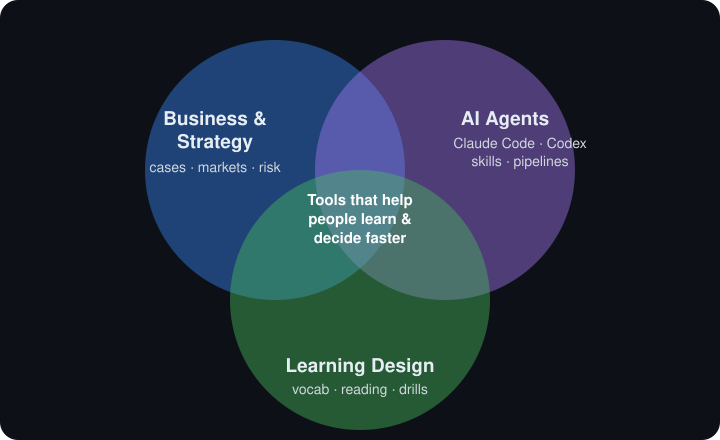

<h1 align="center">Hi, I'm Kevin 👋</h1>

<b>Business student who builds with AI agents.</b> 
BYU student · interested in consulting, finance & learning tools · shipping side projects with Claude Code and Codex

---

I don't come from a traditional CS background. I come from business problems: case interviews, markets, supplier risk, and learning English as a second language. When a workflow annoys me, I build a tool for it with coding agents, ship it as a live page, and use it myself.

## 🧭 Where I work

## ⭐ Featured

| Project | What it is | Try it |
|---|---|---|
| **[Case-Library](https://github.com/kevinguo0351/Case-Library)** | 2,141 consulting cases from 100 MBA casebooks, split into prompt/solution drill JSON with exhibit images. PyMuPDF + Claude pipeline, plus mined patterns and principles. | [How to use](https://github.com/kevinguo0351/Case-Library/blob/main/HOW_TO_USE.md) |
| **[Context Vocab](https://github.com/kevinguo0351/context-vocab-extension)** | Chrome extension: select a word, get an AI explanation from its context, save it to Eudic with the source sentence. | [Chrome Web Store](https://chromewebstore.google.com/detail/context-vocab/dhcdkpkphhkjiaogdpdcfjlanklfdkal) |
| **[词根解码 Etymology Book](https://github.com/kevinguo0351/etymology-book)** | 80-chapter Quarto book that teaches English vocabulary through Latin & Greek roots. | [Read online](https://kevinguo0351.github.io/etymology-book/) |
| **[Meridian](https://github.com/kevinguo0351/meridian-countdown)** | A living countdown lock screen in Three.js. The light shifts as your deadline approaches. | [Live demo](https://kevinguo0351.github.io/meridian-countdown/) |

## 🗂 Projects by theme

**💼 Consulting & Finance**
- [merit-supplier-bridge](https://github.com/kevinguo0351/merit-supplier-bridge): interactive supplier-risk prototype · [demo](https://kevinguo0351.github.io/merit-supplier-bridge/)
- [market-monitor](https://github.com/kevinguo0351/market-monitor): multi-asset dashboard with a daily AI briefing, viewed through Dalio's four quadrants
- [case-connect](https://github.com/kevinguo0351/case-connect): free mock-interview scheduling for students (React + Firebase)
- [options-tutorial](https://github.com/kevinguo0351/options-tutorial): options basics · [read](https://kevinguo0351.github.io/options-tutorial/)

**🤖 AI Agents & Skills**
- [xiaorui 小瑞](https://github.com/kevinguo0351/xiaorui): a voice-first personal agent for elderly users, wired to real ride, food & coffee services
- [json-viz](https://github.com/kevinguo0351/json-viz): turn any JSON into one offline, interactive HTML explorer (stdlib-only Claude Code skill)
- [vocabulary-builder](https://github.com/kevinguo0351/vocabulary-builder): Claude Code skill that turns any wordlist into a study site
- [claude-finance-writing-skills](https://github.com/kevinguo0351/claude-finance-writing-skills): my Claude Code skills & slash commands for finance research and writing
- [write-delicate-letters](https://github.com/kevinguo0351/write-delicate-letters): Codex skill for emotionally precise Chinese letters

**📚 Learning Tools**
- [context-vocab-reader](https://github.com/kevinguo0351/context-vocab-reader): read PDF/EPUB in the browser with context-aware word lookup · [app](https://kevinguo0351.github.io/context-vocab-reader/)
- [engpod](https://github.com/kevinguo0351/engpod): 359 EnglishPod dialogues turned into an Anki deck + web reviewer · [app](https://kevinguo0351.github.io/engpod/)

## 🛠 Tools I use

`Claude Code` `Codex` `Python` `TypeScript` `React` `Three.js` `Quarto` `Streamlit` `GitHub Pages`

---

Most of these started as "I wish this existed." Issues and ideas are welcome.

